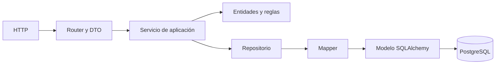

# PostgreSQL y psycopg2

La API usa PostgreSQL 16 con SQLAlchemy y psycopg2 (dependencia psycopg2-binary ya fijada en uv.lock). Compose espera el healthcheck de db antes de aplicar migraciones y arrancar la API. Credenciales incluidas: solo desarrollo local.

```sh
cp .env.example .env
docker compose up --build -d --wait
# Adminer opcional: servidor db, credenciales de .env
docker compose --profile admin up -d
```

Los datos se conservan en postgres_data. Las bases SQLite anteriores no se importan automáticamente. Para ejecutar la API fuera de Docker: levantar db, configurar las variables DB_* de .env y ejecutar alembic upgrade head y uvicorn. DATABASE_URL, si existe, tiene prioridad; eliminar cualquier valor SQLite anterior.

# Referencia de la API

Backend académico para que la administración de un coworking gestione espacios y horarios, y las empresas registren y cancelen reservas sin superposiciones. No incluye frontend, autenticación ni pagos.

Python 3.14, FastAPI, Pydantic, SQLAlchemy y Alembic. PostgreSQL 16 almacena los datos mediante SQLAlchemy y el driver psycopg2. Todos los horarios de atención y reservas se interpretan en **UTC**.

## Ejecutar con Docker Compose

Requisitos: Docker Engine/Desktop con Compose v2 y acceso a Docker Hub, GHCR y PyPI durante la construcción.

```sh
docker compose up --build -d --wait
docker compose logs api
```

El contenedor aplica las migraciones, carga datos iniciales y ejecuta Uvicorn en el puerto 8000. Corre con usuario sin privilegios, tiene healthcheck y se conecta a PostgreSQL en el servicio `db`, con volumen `postgres_data`.

```sh
docker compose exec api alembic current
docker compose exec api alembic check
docker compose exec api python -m infrastructure.seeders
docker compose restart api
docker compose down
```

Para usar otro puerto: `API_PORT=8011 docker compose up -d --wait`.

`down` conserva los datos. **Solo para restablecer datos descartables**, `docker compose down -v` borra el volumen completo; el próximo inicio reconstruye el esquema y los ejemplos.

## Ejecutar sin Docker la API

```sh
uv sync --frozen
cp .env.example .env
docker compose up -d db
uv run --frozen alembic upgrade head
uv run --frozen python -m infrastructure.seeders
uv run --frozen uvicorn app.main:app --reload
```

## Migraciones y carga inicial

```sh
uv run --frozen alembic upgrade head
uv run --frozen alembic current
uv run --frozen alembic check
uv run --frozen python -m infrastructure.seeders
```

La migración `3f7290eb2a4f` crea las cuatro tablas, claves foráneas, restricciones e índices. La carga inicial se ejecuta dentro de una transacción: si falla, se revierte. En una BD vacía crea cinco espacios, tres empresas, horarios de lunes a viernes para espacios activos y dos reservas futuras relacionadas. Repetir la carga no duplica datos; conserva las tablas no vacías. No sirve para reparar cualquier dataset parcial creado manualmente. En pruebas se crea una BD nueva y aislada.

Las reservas de ejemplo se ubican en el siguiente día laborable y tienen una hora de duración. El arranque también verifica/carga los ejemplos; nunca crea el esquema por fuera de Alembic.

## Contrato REST: 19 operaciones

| Recurso | Métodos y rutas | Respuesta exitosa |
|---|---|---|
| Espacios | `POST /espacios` | 201 |
| Espacios | `GET /espacios`, `GET /espacios/{id}` | 200 |
| Espacios | `PUT /espacios/{id}`, `DELETE /espacios/{id}` | 200 / 204 |
| Empresas | `POST /empresas` | 201 |
| Empresas | `GET /empresas`, `GET /empresas/{id}` | 200 |
| Empresas | `PUT /empresas/{id}`, `DELETE /empresas/{id}` | 200 / 204 |
| Disponibilidades | `POST /disponibilidades` | 201 |
| Disponibilidades | `GET /disponibilidades`, `GET /disponibilidades/{id}` | 200 |
| Disponibilidades | `PUT /disponibilidades/{id}`, `DELETE /disponibilidades/{id}` | 200 / 204 |
| Reservas | `POST /reservas` | 201 |
| Reservas | `GET /reservas`, `GET /reservas/{id}` | 200 |
| Reservas | `POST /reservas/{id}/cancelar` | 200 |

Los nombres concretos de parámetros por recurso están en OpenAPI. PUT requiere todos los campos editables. Las reservas conservan su historial mediante cancelación; no se eliminan desde la API.

### Filtro, orden y paginación

```text
GET /espacios?tipo=oficina&estado=activo&ordenar_por=capacidad&direccion=desc&pagina=1&limite=2
```

Se filtra en SQL, se ordena por `nombre`, `capacidad`, `tipo` o `estado`, y finalmente se aplica offset/límite. `direccion` acepta `asc` o `desc`; el UUID desempata para mantener un orden estable. `pagina` inicia en 1 y `limite` acepta 1 a 100. Se admite `tamano` como alias de entrada para clientes anteriores.

```json
{"items": [], "total": 0, "pagina": 1, "limite": 2, "total_paginas": 0}
```

`total` y `total_paginas` corresponden al conjunto filtrado, aunque la página solicitada esté vacía. Empresas filtra por `activa`; disponibilidades por espacio, día y estado; reservas por empresa, espacio, estado y rango `desde`/`hasta`. Las demás colecciones también devuelven los cinco metadatos.

### Errores

```json
{"error":{"code":"RESOURCE_NOT_FOUND","message":"El espacio no existe.","details":[]}}
```

- 400: regla de negocio incumplida, como duración menor a 30 minutos.
- 404: recurso solicitado o referencia relacionada inexistente.
- 409: RUT duplicado, superposición, cancelación repetida o eliminación con referencias.
- 422: datos fuera del esquema; `details` identifica los campos.

La eliminación de espacios o empresas relacionados se rechaza para conservar integridad; no se borran reservas en cascada. PostgreSQL verifica las claves foráneas definidas por la migración.

## Dominio, validaciones y reglas

Cuatro entidades con UUID y al menos cuatro atributos adicionales:

- **Espacio:** nombre, tipo, capacidad y estado.
- **Empresa:** nombre, RUT, contacto y activa.
- **Disponibilidad:** espacio, día de semana, hora de apertura, hora de cierre y activa.
- **Reserva:** espacio, empresa, inicio, fin y estado.

Validaciones: longitud de nombres y RUT; capacidad positiva; día entre 0 y 6; enums de tipo/estado; UUID y fechas ISO con zona horaria; dígito verificador del RUT; existencia de las referencias.

Reglas de negocio comprobables:

1. Una reserva dura al menos 30 minutos y termina después de comenzar.
2. Solo empresas y espacios activos pueden reservar.
3. La reserva debe caber en un horario activo y comenzar/terminar el mismo día UTC.
4. Un espacio o empresa no puede tener reservas activas superpuestas.
5. No se cancela una reserva iniciada ni una ya cancelada.
6. El RUT de empresa es único y se normaliza antes de persistir.

Las fechas de entrada se normalizan a UTC. PostgreSQL almacena las fechas de reserva con zona horaria; la respuesta se normaliza a UTC.

## Arquitectura y recorrido de una petición

| Directorio | Responsabilidad |
|---|---|
| `app/` | Ensamble de FastAPI y ciclo de vida. |
| `presentation/routers/` | HTTP, DTO y delegación; sin consultas SQL. |
| `presentation/schemas/dtos/` | Contratos de entrada/salida y validaciones de esquema. |
| `presentation/dependencies.py` | Sesión por solicitud; commit o rollback del caso de uso. |
| `presentation/errors.py`, `presentation/openapi.py` | Formato HTTP de errores y documentación del contrato. |
| `application/services/` | Casos de uso, coordinación y reglas entre recursos. |
| `domain/` | Entidades, reglas y errores independientes de FastAPI/SQLAlchemy. |
| `infrastructure/models/` | Tablas y relaciones ORM. |
| `infrastructure/mappers/` | Conversión entre ORM y dominio. |
| `infrastructure/repositories/` | Consultas y persistencia; flush dentro de la transacción externa. |
| `infrastructure/seeders/`, `migrations/` | Datos de ejemplo y evolución versionada del esquema. |



Ejemplo: `POST /reservas` valida el DTO; el servicio consulta espacio, empresa y disponibilidad, verifica duración y superposición; el repositorio convierte con el mapper e inserta el modelo; la dependencia confirma la transacción y la ruta devuelve el DTO con 201. Un error revierte la transacción.

Diagramas de clases y datos: [docs/modelo.md](docs/modelo.md). Matriz de cumplimiento y resumen de cambios: [docs/rubrica_codigo.md](docs/rubrica_codigo.md).

## Pruebas y evidencias reproducibles

```sh
docker compose up -d db
uv run --frozen python tests_manual/run_checks.py
# O ejecutar la misma prueba dentro de la imagen:
docker compose exec api python tests_manual/run_checks.py --report /tmp/results.json
docker compose cp api:/tmp/results.json tests_manual/results.docker.json
```

La suite usa psycopg2 y las dependencias del proyecto, crea dos bases PostgreSQL con nombres aleatorios, aplica migraciones, ejecuta seeders dos veces y levanta su propio servidor en un puerto libre. Verifica las 19 operaciones, CRUD, errores uniformes, reglas, consulta combinada e integridad. Detiene y vuelve a iniciar el proceso para verificar datos modificados y reservas persistentes. Finalmente elimina únicamente las bases que creó, incluso ante fallos, sin tocar la base de desarrollo. Requiere que el usuario DB_USER tenga permiso CREATEDB (el usuario de Compose lo tiene). Configura DB_HOST, DB_PORT, DB_USER y DB_PASSWORD; no usa DATABASE_URL de desarrollo para elegir la base de prueba.

[tests_manual/results.json](tests_manual/results.json) y [tests_manual/results.docker.json](tests_manual/results.docker.json) registran 72 comprobaciones HTTP exitosas en local y dentro de Docker. [tests_manual/compose_results.json](tests_manual/compose_results.json) registra healthcheck y persistencia tras recrear el contenedor. El reporte de cada suite conserva solicitudes, entradas, resultados esperados y obtenidos de la última ejecución exitosa. La salida del proceso es distinta de cero ante fallos. [tests_manual/casos.md](tests_manual/casos.md) explica los escenarios y [tests_manual/requests.http](tests_manual/requests.http) permite una demostración complementaria.

## Decisiones y limitaciones

PostgreSQL y su volumen permiten separar la API de la persistencia. Las restricciones e índices cubren integridad básica. La prevención de solapamientos consulta antes de insertar: una futura versión concurrente debería incorporar restricciones de exclusión o bloqueo transaccional en PostgreSQL. No se garantiza la exclusión entre solicitudes simultáneas en varios workers.

No incluye autenticación, control de acceso ni pagos; no es una configuración lista para producción. No se requieren frontend, CI/CD ni porcentaje de cobertura para esta entrega.

## Equipo y evidencias Git pendientes de completar por el grupo

Integrantes informados: **Vicente, Annan y Matias**. Ver [registro del equipo](docs/equipo.md). Quedan por confirmar cuentas GitHub, jefe de grupo y asignación de coordinación, dominio/datos, API/lógica, calidad/pruebas y documentación/integración. Cada integrante debe acreditar cinco commits significativos, una rama distinta de main y un PR. Revisar con el docente el nombre solicitado `backend-2026-grupo-XX`. Estos requisitos y la defensa no se sustituyen con cambios técnicos.

## Redes con proxy o CA institucional

La construcción conserva la verificación TLS y los hashes de `uv.lock`. Si tu red usa una CA propia, se admite un montaje temporal de BuildKit:

```sh
docker build --secret id=ca_bundle,src=/ruta/al/bundle-ca.pem -t coworking-api:local .
docker compose up --no-build -d --wait
```

El bundle debe provenir del administrador de la red. No se copia a la imagen. Docker admite `--build-arg HTTP_PROXY --build-arg HTTPS_PROXY --build-arg NO_PROXY` para usar variables existentes; la resolución del proxy debe estar disponible en la red de construcción. En el entorno en la nube de esta revisión se necesitó además resolver su proxy para el build. No se desactivó TLS.

## Entrega y defensa

- [Problemática P1–P7](docs/problematica.md).
- [Presentación de 10 diapositivas](docs/presentacion.html) y [guion de ensayo](docs/defensa.md).
- [Equipo y evidencias pendientes](docs/equipo.md).

## Verificar persistencia al recrear la API

Con la pila iniciada y desde la raíz del repositorio:

```sh
uv run --frozen python tests_manual/check_compose.py --project sql
```

Usar el nombre de proyecto Compose real si se inició con `-p`. Esta prueba crea un espacio propio, recrea solamente la API (interrumpe sus conexiones), verifica el mismo UUID/capacidad y elimina ese espacio. Conserva la base PostgreSQL y sus demás datos. No ejecutarla simultáneamente con la suite dentro del contenedor. El resultado queda en tests_manual/compose_results.json.
