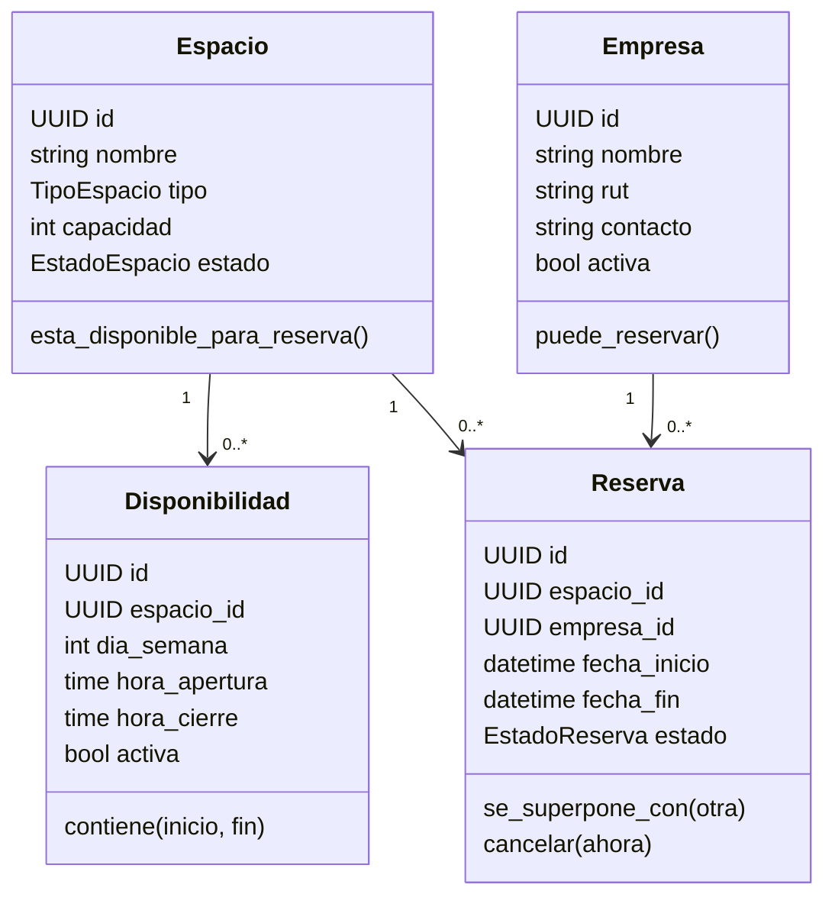
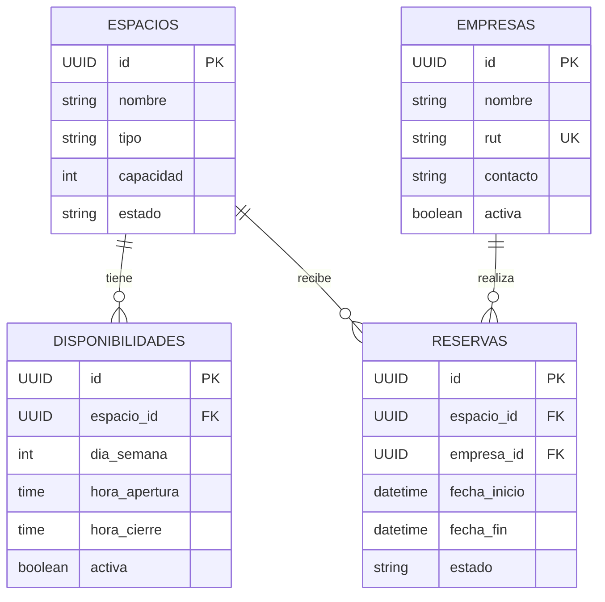

# Modelo del coworking

## Clases de dominio

## Modelo de datos persistido

Cada disponibilidad/reserva requiere su espacio; cada reserva requiere su empresa. Existen relaciones 1:N tanto en claves foráneas como en `relationship(back_populates=...)`. La API verifica referencias y la BD impide borrados que dejarían registros huérfanos. Las reservas canceladas conservan las relaciones y el historial.

La migración inicial crea UUID, restricciones de capacidad, estados, horarios y fechas; índice único de RUT e índices de consultas de reservas por empresa/espacio y fechas.
